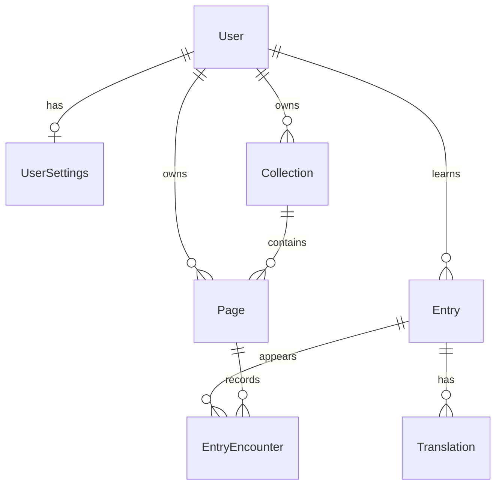

# LangStore — Current Schema
Updated: 4 November 2026

Implementation-ready PostgreSQL schema contract. This is not executable SQL or a Drizzle migration. See [langstore-schema-decisions.md](langstore-schema-decisions.md) for rationale and decisions outside the schema.

## Tables

`PK` = primary key; `FK` = foreign key; `NULL` = nullable. All UUID primary keys default to `gen_random_uuid()`. All timestamps are `timestamp(3) with time zone NOT NULL DEFAULT now()`. Nullable fields default to `NULL`. Required fields without an explicit default must be supplied by the write operation.

```text
User
  id: uuid PK
  username: text NULL
  email: text NOT NULL UNIQUE
  providerId: text NOT NULL UNIQUE
  createdAt: timestamp(3) with time zone NOT NULL DEFAULT now()

UserSettings
  userId: uuid PK, FK → User.id ON DELETE CASCADE
  targetLanguage: char(2) NOT NULL, CHECK targetLanguage ~ '^[a-z]{2}$'
  userLanguage: char(2) NOT NULL, CHECK userLanguage ~ '^[a-z]{2}$'

Collection
  id: uuid PK
  name: text NOT NULL
  description: text NULL
  imgUrl: text NULL
  userId: uuid NOT NULL, FK → User.id ON DELETE CASCADE
  iso: char(2) NOT NULL, CHECK iso ~ '^[a-z]{2}$'
  UNIQUE(id, userId)

Page
  id: uuid PK
  userId: uuid NOT NULL, FK → User.id ON DELETE CASCADE
  collectionId: uuid NOT NULL
  name: text NOT NULL
  description: text NULL
  summary: text NULL
  createdAt: timestamp(3) with time zone NOT NULL DEFAULT now()
  FK (collectionId, userId) → Collection(id, userId) ON DELETE CASCADE

Entry
  id: uuid PK
  text: text NOT NULL
  userId: uuid NOT NULL, FK → User.id ON DELETE CASCADE
  createdAt: timestamp(3) with time zone NOT NULL DEFAULT now()
  iso: char(2) NOT NULL, CHECK iso ~ '^[a-z]{2}$'

Translation
  id: uuid PK
  text: text NOT NULL
  entryId: uuid NOT NULL, FK → Entry.id ON DELETE CASCADE
  createdAt: timestamp(3) with time zone NOT NULL DEFAULT now()

EntryEncounter
  id: uuid PK
  entryId: uuid NOT NULL, FK → Entry.id ON DELETE CASCADE
  pageId: uuid NOT NULL, FK → Page.id ON DELETE CASCADE
  count: integer NOT NULL DEFAULT 1, CHECK count > 0
  createdAt: timestamp(3) with time zone NOT NULL DEFAULT now()
  UNIQUE(entryId, pageId)
```

Primary and foreign keys are immutable and use `ON UPDATE NO ACTION`. Text fields must contain at least one non-whitespace character when present; enforce this in request/application validation. `email` is stored trimmed and lowercased before insertion. The database uniqueness constraint applies to that stored representation.

Language fields contain lowercase ISO 639-1 alpha-2 codes. PostgreSQL check constraints enforce `^[a-z]{2}$`; application validation additionally rejects unassigned codes using the ISO 639-1 registry. v0 accepts every assigned ISO 639-1 code unless a later product decision narrows the set.

The count field is included as the working representation discussed: one row per entry per page, with the number of appearances on that page. It does not represent learning proficiency.

## Relationships



A user has at most one settings row. Settings are created explicitly through the settings write operation after user provisioning; user creation does not invent language defaults. Reading missing settings returns not found, and features requiring a selected language return a settings-required error. Each page belongs to exactly one collection. Each translation belongs to exactly one entry. An entry may initially have no translations and may later have many. An entry may appear on many pages, and each page may contain many learning entries.

## Ownership and language rules

- Page.userId must match its collection's owner.
- An encounter must connect an entry and a page belonging to the same user.
- Entry.iso must match the language of the collection containing the encounter's page.
- Translations inherit ownership through Entry. Their language is intentionally untracked.
- Collection.iso defines the language of its pages and summaries; collections are not multilingual.
- UserSettings.targetLanguage and userLanguage contain language codes. userLanguage means the user's native language.
- Changing targetLanguage changes display/query filters, not stored languages or existing content.
- Keep iso only on Collection and Entry. Do not add it to User, UserSettings, Page, Translation, or EntryEncounter.

## Query paths

| Query | Path and conditions |
| --- | --- |
| Collections in the selected language | Collection.userId = authenticated user; Collection.iso = targetLanguage. |
| Pages in the selected language | Page.userId = authenticated user; join Collection and filter its iso. |
| Latest uploaded page in the selected language | Same page filter; order by Page.createdAt descending, then Page.id descending; take one. |
| Learning entries from a page | Page → EntryEncounter → Entry; enforce ownership; load translations separately or aggregate them. |
| Learning entries from a collection | Collection → Page → EntryEncounter → Entry; return distinct entries and optionally sum counts across its pages. |
| All learning entries in the selected language | Entry.userId = authenticated user; Entry.iso = targetLanguage. |

Do not multiply encounter counts by joining multiple translations before summing. Aggregate encounters first or retrieve translations separately.

Latest uploaded is not independently recorded latest read; no lastReadAt field has been agreed.

## Write and retry semantics

- Application services may allocate a Page UUID before persistence. Repeating Page creation with the same UUID and the same creation fields (`userId`, `collectionId`, `name`, and `description`) returns the existing Page without creating another row.
- Reusing a Page UUID with different creation fields is a conflict. `summary` is excluded because it is generated and updated after Page creation; `createdAt` is database-generated.
- Uploading the same content with a new Page UUID creates another Page; duplicate-page detection remains out of scope.
- EntryEncounter writes provide the absolute occurrence count for one Entry on one Page. Insert the pair once; on conflict, replace `count` with the submitted absolute count rather than incrementing it.
- Replaying the same EntryEncounter write is therefore idempotent. A later corrected count replaces the earlier count.
- EntryEncounter writes must verify in one transaction that Entry and Page have the same owner and that Entry.iso matches the Page Collection.iso.

## Required indexes and deferred uniqueness

- Add indexes on Page(userId, createdAt, id), Page(collectionId), Collection(userId, iso), Entry(userId, iso), Translation(entryId), and EntryEncounter(pageId, entryId).
- Do not add a uniqueness rule for (userId, iso, text) until entry text normalisation is agreed.

## Deliberately not represented yet

No raw page text/image retention fields, chat messages, review sessions, mastery scores, canonical-form grouping, meaning entities, or duplicate-upload detection. Their omission must not be read as an implementation of those capabilities.
